# NSE Market Data Pipeline — Airflow + dbt + PostgreSQL

An automated, tested daily data pipeline for **50 large-cap NSE stocks + the Nifty 50 index**: it loads prices from Yahoo Finance, transforms and **tests** them with dbt, runs on a schedule with Airflow, and serves a Streamlit dashboard — plus a market-insights analysis on top of the validated data.
**Python · PostgreSQL · dbt · Apache Airflow · Streamlit · SQL · WSL (Ubuntu)**

> For learning and analysis only — not investment advice.

---

## Key Results
- **Automated:** Airflow runs `load → freshness check → dbt build` every weekday at **18:30 IST** (NSE closes 15:30); full run ≈ **1–2 minutes**
- **Incremental and idempotent:** loads only new days with a 7-day look-back; re-runs proven to change nothing (0 duplicate keys)
- **23 data-quality tests** (16 generic + 7 custom) with an error/warn policy; a failing test **skips the downstream marts**, so analysts never see bad data
- **The tests caught real source errors**, verified against news and NSE circulars:
  - **Trent:** a 1:2 bonus adjustment applied **5 months early** (fake −33% "crash"; price 2864.9333 = 4297.40 ÷ 1.5, not a valid NSE tick) → corrected
  - **Tata Motors PV:** demerger day not adjusted (fake −40%) → corrected
  - **Phantom rows for all 50 stocks on 15 Jan 2026**, an NSE holiday declared for the Maharashtra civic elections → removed
  - **A lost trading day for 49 stocks** (18 Mar 2025) and 9 single-stock gaps → reported as warnings
  - **Late data** (two stocks a day late) → held back by the up-to-date test, then filled automatically by the next scheduled run
- **Insights:** over the last year the Nifty returned −0.9% while the median stock gained +3.2%; low-volatility stocks earned the same 5-year growth as high-volatility ones with much shallower falls; IT was the strongest diversifier (average correlation 0.15)

---

## Architecture
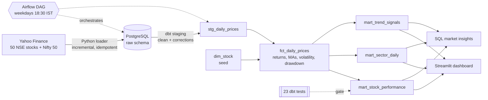

| Layer | What happens |
|---|---|
| Extract & load (`extract/load_prices.py`) | Backfill or incremental; `INSERT … ON CONFLICT DO UPDATE`; 7-day look-back; 3 retries; per-symbol transactions; skips today's bar before 16:00 IST; every run logged to `raw.load_log` |
| Transform (`dbt/`) | Staging (clean names, documented price corrections, no-trade placeholder rows removed) → star schema (`dim_stock`, `fct_daily_prices`) → 3 marts |
| Test (`dbt build`) | Uniqueness, not-null, accepted values, relationships, valid OHLC, no missing trading days (Nifty as the trading calendar), all stocks up to date, index beta = 1; warnings for stale prices, unreviewed >20% moves, source gaps; source freshness |
| Orchestrate (`dags/nse_market_pipeline.py`) | `load_prices → dbt_source_freshness → dbt_build`; retries for the load only; timeouts; `max_active_runs=1`; failure alert to `logs/alerts.log` |
| Serve (`dashboard/app.py`) | Streamlit dashboard reading only tested marts, with a Pipeline health tab |

---

## Airflow
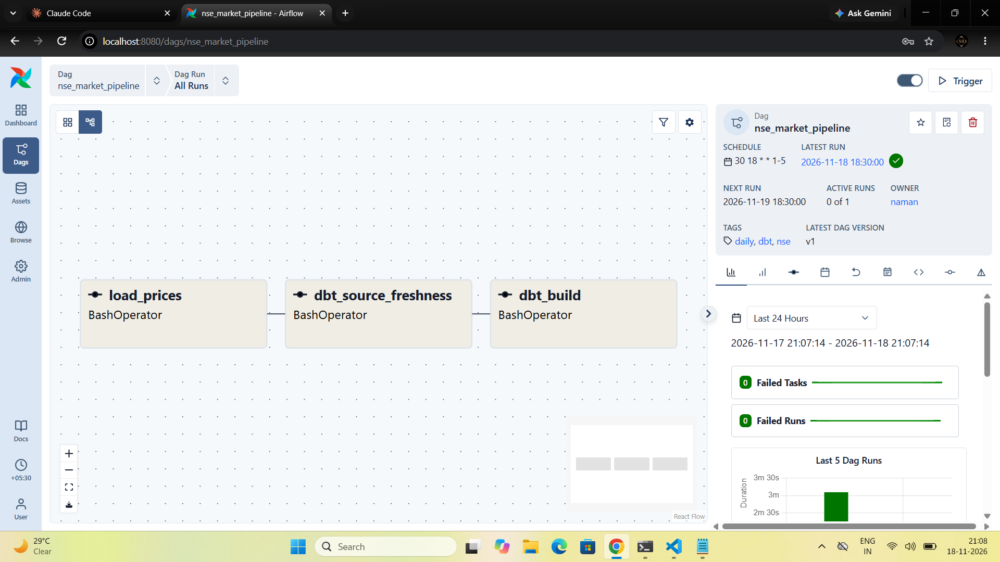
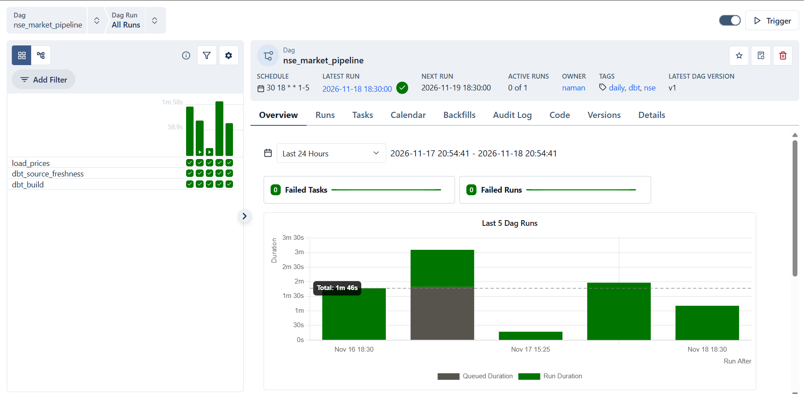

**Failure test:** a planted impossible price failed `assert_valid_ohlc`, the marts were skipped, an alert was written, and after the fix only `dbt_build` was re-run (try 1 ❌ → try 2 ✅):
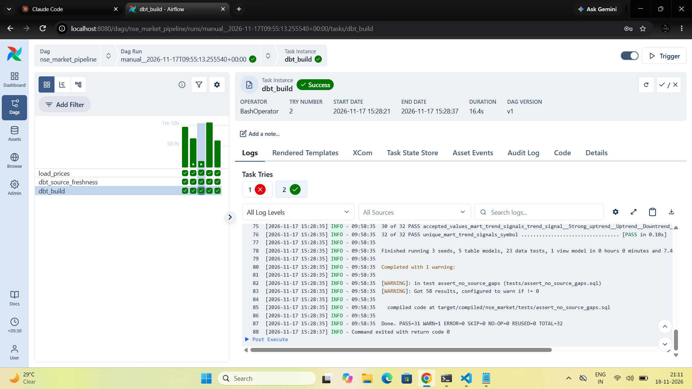

## dbt build
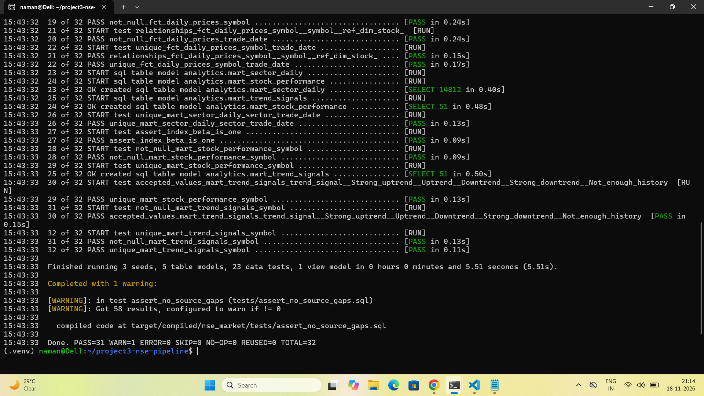

## Dashboard
| | |
|---|---|
| 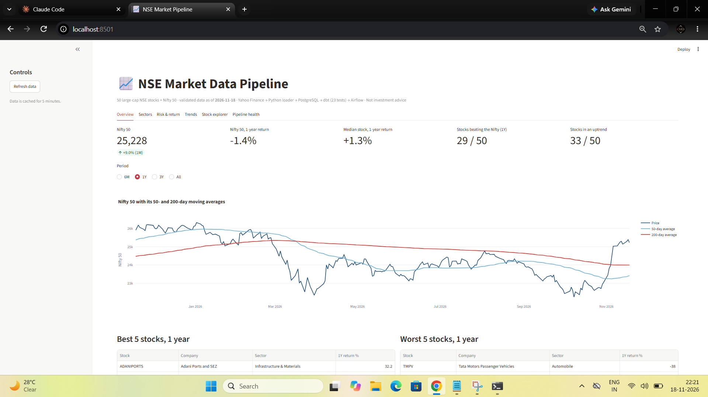 | 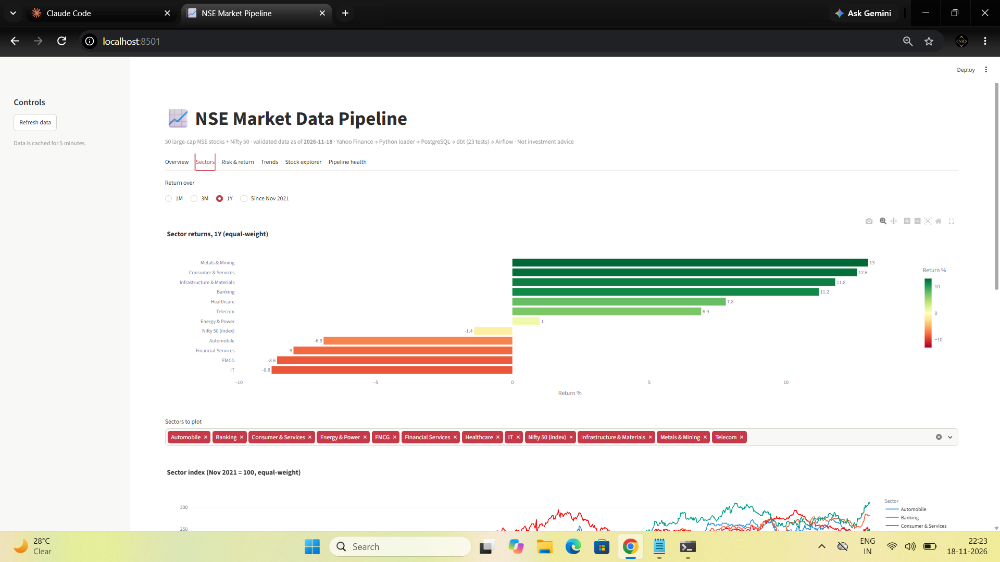 |
| 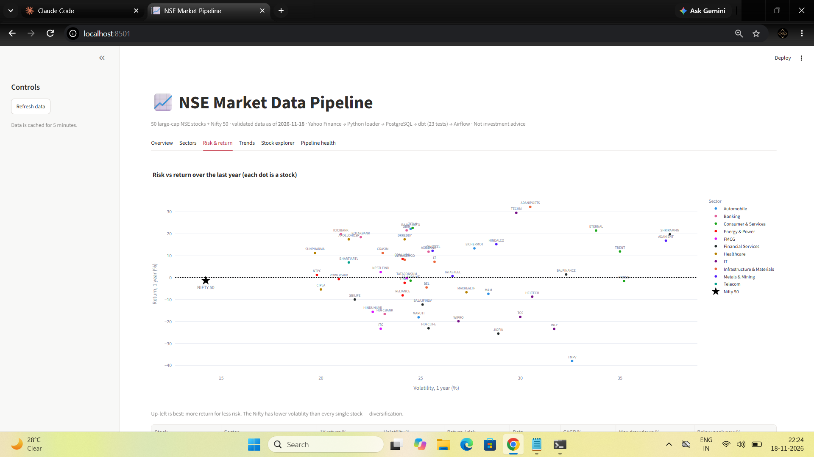 | 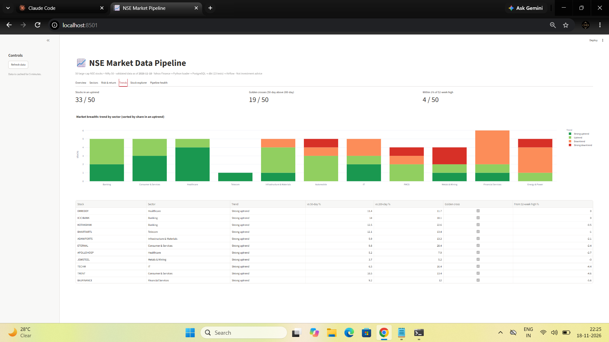 |
| 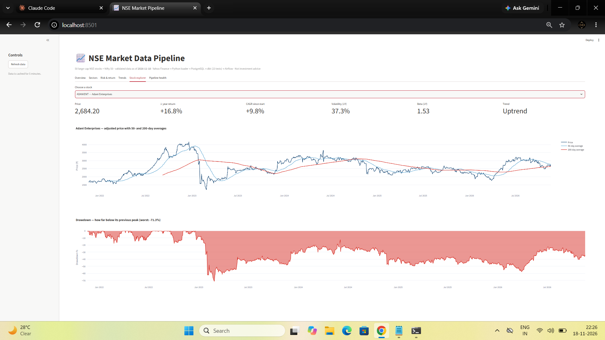 | 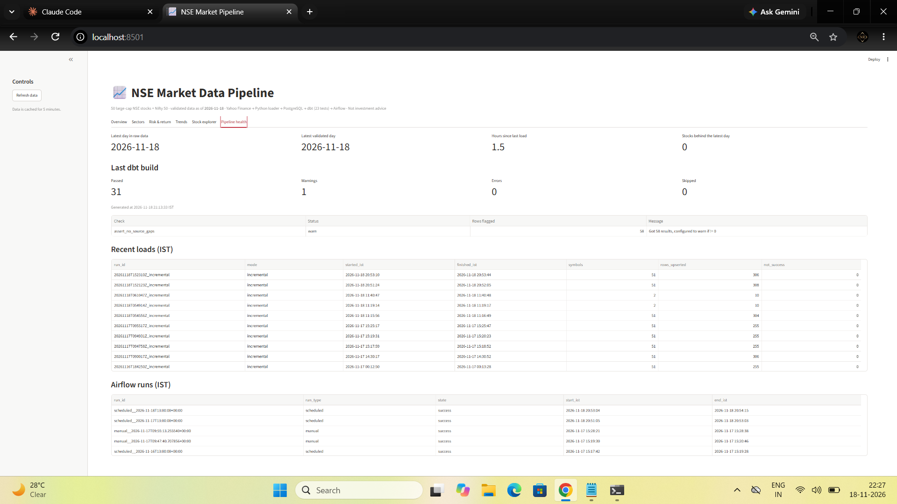 |

---

## Project Structure
```
project3-nse-pipeline/
├── extract/
│   ├── stock_universe.csv        # 50 stocks + Nifty 50, with sectors
│   ├── validate_universe.py      # checks every symbol returns data
│   └── load_prices.py            # backfill / incremental loader
├── dbt/
│   ├── dbt_project.yml, profiles.yml   # profile has no password (uses ~/.pgpass)
│   ├── models/staging/           # sources.yml, stg_daily_prices.sql
│   ├── models/marts/             # dim_stock, fct_daily_prices, 3 marts, schema.yml (tests)
│   ├── seeds/                    # stock_universe (link), price_adjustments, reviewed_extreme_moves
│   └── tests/                    # 7 custom data tests
├── dags/nse_market_pipeline.py   # Airflow DAG
├── dashboard/app.py              # Streamlit app
├── sql/                          # 00_raw_schema.sql + 6 market-insight queries
├── docs/                         # design, extract & load, transformations, data quality,
│                                 # orchestration, market insights, dashboard
├── images/                       # screenshots
├── airflow.env                   # Airflow settings (no secrets)
├── requirements-pipeline.txt     # .venv      (Airflow + loader)
├── requirements-dbt.txt          # .venv-dbt  (dbt)
├── requirements-dashboard.txt    # .venv-app  (Streamlit)
└── README.md
```

## Documentation
| Document | Contents |
|---|---|
| [`project_design.md`](docs/project_design.md) | Objective, stakeholders, 10 business questions, architecture, data contract |
| [`extract_load.md`](docs/extract_load.md) | Universe validation, raw tables, loader features, idempotency proof |
| [`transformations.md`](docs/transformations.md) | dbt lineage, models, calculations, price corrections |
| [`data_quality.md`](docs/data_quality.md) | All tests, findings and fixes |
| [`orchestration.md`](docs/orchestration.md) | Airflow setup, DAG settings, verified runs, failure test |
| [`market_insights.md`](docs/market_insights.md) | Sector, risk, beta, trend, correlation and drawdown analysis |
| [`dashboard.md`](docs/dashboard.md) | Dashboard design and tabs |

---

## How to Run
**Prerequisites:** Linux or WSL 2 (Ubuntu 24.04), Python 3.12, PostgreSQL with a database `nse_market` and a `~/.pgpass` entry (`chmod 600`).

1. **Three virtual environments** (one per tool, to avoid dependency conflicts):
   ```
   python3 -m venv .venv && .venv/bin/pip install "apache-airflow[postgres]==3.4.0" yfinance --constraint "https://raw.githubusercontent.com/apache/airflow/constraints-3.4.0/constraints-3.12.txt"
   python3 -m venv .venv-dbt && .venv-dbt/bin/pip install -r requirements-dbt.txt
   python3 -m venv .venv-app && .venv-app/bin/pip install -r requirements-dashboard.txt
   ```
2. **Raw tables and the 5-year backfill:**
   ```
   psql -h localhost -U postgres -d nse_market -f sql/00_raw_schema.sql
   .venv/bin/python extract/load_prices.py --mode backfill
   ```
3. **Build and test:**
   ```
   cd dbt && ../.venv-dbt/bin/dbt build && cd ..
   ```
4. **Airflow** (UI at http://localhost:8080):
   ```
   psql -h localhost -U postgres -c "CREATE DATABASE airflow_meta;"
   source airflow.env && .venv/bin/airflow db migrate && .venv/bin/airflow standalone
   ```
5. **Dashboard** (http://localhost:8501):
   ```
   .venv-app/bin/streamlit run dashboard/app.py --server.headless true
   ```

---

## Limitations
- **Yahoo Finance** is a free, unofficial source; errors found are documented and corrected or flagged, but a production system would use licensed exchange data
- **Survivorship bias:** the universe is today's large caps; sector indices are equal-weighted
- Runs locally: the schedule only fires while the machine, WSL and Airflow are on; alerts go to a log file instead of email/Slack
- No NSE holiday calendar in the schedule (a holiday run simply finds no new day)

---

## Author
**Naman Rajyagor** · [LinkedIn](https://www.linkedin.com/in/naman-rajyagor-51828228b)